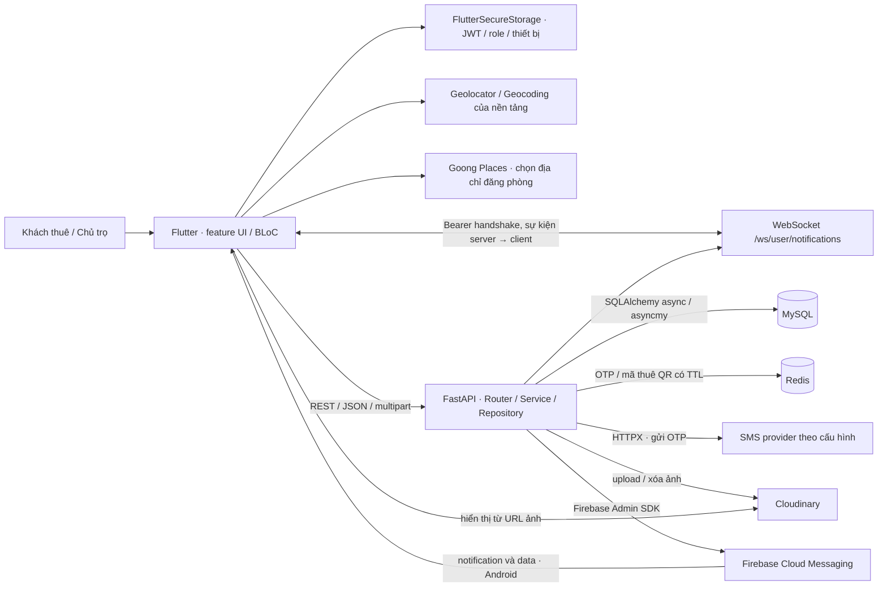

# 01 · Tổng quan hệ thống

RoomIO kết nối khách thuê với chủ trọ từ lúc tìm phòng và trao đổi đến khi đặt lịch xem và ghi nhận quan hệ thuê. Chủ trọ quản lý tin đăng, lịch hẹn và khách đang thuê. Phạm vi này thể hiện qua các trang trong `FE lib/features` và các router gắn ở `BE app/api/router.py`.

## Vai trò

| Vai trò | Hành vi có bằng chứng |
| --- | --- |
| Khách thuê (`CUSTOMER`) | Tạo hồ sơ, tìm/lưu phòng, liên hệ chủ trọ, tạo/đổi/hủy lịch, xác nhận thuê qua QR, xem phòng đang thuê và đánh giá phòng đã thuê. `FE HomePage`, `AppRoutes`, `BE RentalService._get_tenant` và `ReviewService.post_review`. |
| Chủ trọ (`LANDLORD`) | Quản lý hồ sơ và danh sách phòng, tạo tin sau khi `is_verify`, cập nhật trạng thái phòng, xử lý lịch hẹn, tạo QR và chấm dứt quan hệ thuê. `BE RoomService`, `AppointmentService`, `RentalService`. |
| Quản trị viên | Backend có API danh sách thành viên/phòng, xác minh chủ trọ, khóa tài khoản và xóa phòng. **Partial** vì router thiếu xác thực/phân quyền và Flutter không có feature admin. `BE app/api/v1/admin.py`, `FE lib/features`. |
| Khách gọi API công khai | Catalog, địa điểm, chi tiết phòng, đánh giá và tìm kiếm có thể truy cập qua REST. **Partial** nếu xét trải nghiệm khách trên Flutter, vì app mở luồng đăng nhập và `RoomRouteGate` yêu cầu phiên cục bộ. `BE app/api/v1/{room,review,amenitie,interior}.py`, `FE lib/main.dart` và `lib/config/route/room_route_gate.dart`. |

## Tính năng đã đối chiếu

| Tính năng | Trạng thái | Bằng chứng và giới hạn |
| --- | --- | --- |
| Đăng nhập, refresh, logout | **Implemented** cho REST, **Partial** cho vòng đời phiên Flutter | `AccountService`, `AccountRepository`, `AppInterceptor` và `RemoteAppAuthBloc`. Callback hết hạn tra factory BLoC khác instance UI. |
| OTP đăng ký và quên mật khẩu | **Partial** | `AccountService.send_otp/verify_otp` có SMS và Redis. `register/reset_password` bỏ qua bằng chứng xác minh. |
| Hồ sơ theo vai trò, avatar | **Implemented** cho tạo/đọc và sửa hồ sơ tenant, **Partial** cho sửa hồ sơ chủ trọ | `TenantService`, `LandlordService`, `RemoteProfileBloc`. Flutter gửi `fullName` nhưng PATCH landlord yêu cầu `full_name`. Upload avatar công khai. Hồ sơ yêu cầu Bearer nhưng thiếu ràng buộc vai trò tập trung. |
| Tạo, xem, liệt kê phòng và catalog | **Implemented** | `RoomService.postRoom/getDetailRoom/getListRoom`, `RoomCatalogApiService`. Tải ảnh theo hai bước Cloudinary rồi DB. |
| Sửa phòng | **Partial** | UI và `PATCH /rooms/{room_id}` có khai báo, `RoomService.updateRoom` chưa tồn tại. PATCH trạng thái riêng thực thi nhưng thiếu ownership. |
| Tìm kiếm theo vị trí/địa chỉ/khu vực | **Implemented** với luồng tenant có hồ sơ, **Partial** với một số phiên khác | `SearchRoomsPage`, `RemoteTenantRoomBloc`, `RoomLocationDataSource`, `RoomRepository.getRoomByPositionDistance`. Bearer của tài khoản thiếu hồ sơ tenant có thể gây 500. Goong phục vụ chọn địa chỉ khi đăng tin. |
| Phòng yêu thích | **Implemented** | `SavedRoomsCubit`, `RoomSaveRepository`. Bỏ lưu bằng trạng thái và kích hoạt lại theo khóa ghép. |
| Lịch xem phòng | **Implemented** | `AppointmentService`, `RemoteAppointmentBloc`. Có tạo, liệt kê, đổi, hủy, xác nhận, từ chối và hoàn tất. |
| Quan hệ thuê qua QR | **Implemented** | `RentalService`, `RentalQRCodePage`, `RentalScanPage`. Mã Redis một lần, quan hệ trong MySQL. |
| Đánh giá | **Implemented** | `ReviewService`, `ReviewBloc`, `RoomReviewSection`. Người từng hoặc đang thuê được tạo. Sửa/xóa theo tác giả. |
| Chat | **Implemented** cho gửi/đọc REST, **Partial** cho delivery realtime | `ChatService`, `ChatRepositoryImpl`, `ChatWebSocketService`. WS dùng map trong một process, có REST lấy lại lịch sử. |
| Inbox thông báo và Firebase Push | **Implemented** cho inbox lịch hẹn, **Partial** cho Push | `NotificationService`, `AppointmentService`, `PushNotificationService`, `FcmService`. Client Push giới hạn Android và contract đăng ký thiết bị có lệch UUID/str. |
| Hạ tầng production, CI/CD và môi trường đang vận hành | **Unknown** | Source có startup/config và một URL HTTPS cố định ở client. Xem [Deployment](06-DEPLOYMENT.md) để phân biệt cấu hình hiện có với kế hoạch. |

## Kiến trúc tổng thể

Push và WebSocket có thể cùng phát sau commit. MySQL giữ lịch sử chat và lịch hẹn, còn map socket chỉ giữ kết nối đang mở. Xem `BE ChatService.send_message`, `AppointmentService._commit_and_notify` và `app/websocket/user.py`.

## Stack và phiên bản

Phiên bản Backend lấy từ `BE requirements.txt`. Đây là khai báo dependency. Phiên bản package Flutter lấy từ `FE pubspec.lock`. `FE pubspec.yaml` yêu cầu Dart `^3.11.5`, lockfile ghi Flutter `>=3.41.0`. SDK local đọc từ metadata cache là Flutter stable **3.41.7**, Dart **3.11.5**. Backend `.venv/pyvenv.cfg` ghi Python **3.12.10**, repo không pin Python toàn dự án.

| Phạm vi | Công nghệ và phiên bản | Điểm dùng thực tế |
| --- | --- | --- |
| HTTP và schema | FastAPI 0.141.1, Starlette 1.6.0, Uvicorn 0.52.4, Pydantic 2.13.5, pydantic-settings 2.15.0, python-multipart 0.0.32 | `app/main.py`, `schemas/base.py`, `core/config.py` và các route `File/Form`. Uvicorn là ASGI runner khai báo. |
| Persistence | SQLAlchemy 2.0.52, asyncmy 0.2.14, Alembic 1.19.2, MySQL | `core/config.py`, `alembic/env.py`, `RoomRepository.getRoomByPositionDistance`. Phiên bản server MySQL chưa xác minh. |
| Auth và TTL | PyJWT 2.13.0, passlib 1.7.4, bcrypt 4.0.1, redis-py 8.1.0, HTTPX `~=0.28.1` | `core/security.py`, `core/redis_custom.py`, `core/sms_custom.py`, `RentalService`. Phiên bản Redis server chưa xác minh. |
| Media và Push | Cloudinary SDK 1.46.2, firebase_admin `~=7.7.0` | `core/cloudinary_custom.py`, `core/firebase.py`, `PushNotificationService`. |
| Flutter state và DI | flutter_bloc 9.1.1, equatable 2.1.0, get_it 9.2.1, dartz 0.10.1, flex_color_scheme 8.4.0 | `lib/injection_container.dart`, BLoCs, `ChatRepositoryImpl`, `AppTheme`. |
| Flutter transport và storage | Retrofit 4.10.0, Dio 5.11.1, web_socket_channel 3.0.3, flutter_secure_storage 11.2.0 | Các `*ApiService`, `AppInterceptor`, `ChatWebSocketService` và `SecureStorageService`. |
| Flutter khả năng thiết bị | image_picker 1.2.4, geolocator 14.1.1, geocoding 5.0.0, qr_flutter 4.1.0, mobile_scanner 7.4.2 | `RoomPhotoPicker`, `RoomLocationDataSource`, trang QR/scan. Goong gọi REST trực tiếp từ app. |
| Flutter Push và codegen | firebase_core 5.1.0, firebase_messaging 17.0.1, flutter_local_notifications 22.3.3, build_runner 2.15.1, retrofit_generator 10.2.9 | `FcmService`, Gradle/manifest Android, các tệp `*.g.dart`. |
