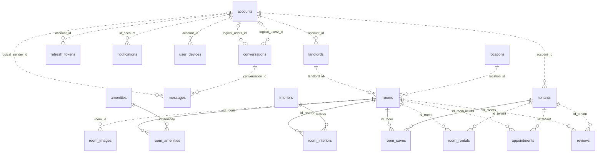

# 04 · Thiết kế database

Metadata `db.base.Base` có **19 bảng nghiệp vụ**, nạp từ 19 model dưới `BE models/`. Bảng tracking `alembic_version` thuộc Alembic. Mô tả dưới đây lấy từ SQLAlchemy metadata, chưa đối chiếu schema hoặc dữ liệu MySQL đang chạy.

## Model, khóa và indexes

`UUID` là SQLAlchemy `Uuid` suy ra từ `Mapped[uuid.UUID]`. PK đơn `id` mặc định `uuid4` phía ORM. Mọi cột trong metadata hiện là NOT NULL. `IX` liệt kê index khai báo ngoài PK. `UQ` liệt kê unique constraint. Không tính index MySQL tự tạo để hỗ trợ FK. Mặc định dưới đây là Python/ORM default.

| Bảng · model/tệp trong `models/` | PK và FK | Cột còn lại | IX / UQ |
| --- | --- | --- | --- |
| `accounts` · `Account`, `account.py` | `id` | `password VARCHAR(255)` chứa hash, `phone_number VARCHAR(255)`, `role VARCHAR(20)`, `state VARCHAR(20)` mặc định `ok` | UQ `phone_number` |
| `amenities` · `Amenity`, `amenitie.py` | `id` | `name VARCHAR(255)` | UQ `name` |
| `appointments` · `Appointment`, `appointment.py` | `id`, `id_room → rooms.id`, `id_tenant → tenants.id` | `meet_at DATETIME`, `status VARCHAR(255)` mặc định `PENDING` | IX `id_room`, `id_tenant` |
| `conversations` · `Conversation`, `conversation.py` | `id`. `user1_id`, `user2_id` là UUID logic, không có FK | `last_message VARCHAR(500)`, `updated_at DATETIME` UTC | IX `id`, `user1_id`, `user2_id` |
| `interiors` · `Interior`, `interior.py` | `id` | `name VARCHAR(255)` | UQ `name` |
| `landlords` · `LandLord`, `landlord.py` | `id`, `account_id → accounts.id` | `full_name VARCHAR(255)`, `gender VARCHAR(20)`, `avatar/description VARCHAR(500)`, `is_verify BOOLEAN` mặc định false | IX `account_id` |
| `locations` · `Location`, `location.py` | `id` | `name/type VARCHAR(255)`, `longitude/latitude FLOAT`. Service phân biệt `address` và `area` | — |
| `messages` · `Message`, `message.py` | `id`, `conversation_id → conversations.id`. `sender_id` UUID logic | `content VARCHAR(500)`, `status VARCHAR(50)` mặc định `active`, `created_at DATETIME` UTC | IX `id`, `conversation_id`, `sender_id` |
| `notifications` · `Notification`, `notification.py` | `id`, `id_account → accounts.id` | `content VARCHAR(500)`, `is_read BOOLEAN` mặc định false, `created_at DATETIME` UTC | IX `id_account` |
| `refresh_tokens` · `RefreshToken`, `rf_token.py` | `id`, `account_id → accounts.id` | `token TEXT` (SHA-256 hex), `is_revoked BOOLEAN` mặc định false | IX `account_id` |
| `reviews` · `Review`, `review.py` | `id`, `id_tenant → tenants.id`, `id_rooms → rooms.id` | `content VARCHAR(255)`, `rating FLOAT` mặc định 1, `created_at DATETIME` UTC, `status VARCHAR(50)` mặc định `active` | IX `id`, `id_tenant`, `id_rooms` |
| `room_amenities` · `RoomAmenity`, `room_amenitie.py` | PK ghép `(id_room, id_amenity)`, FK đến `rooms.id` và `amenities.id` | — | — |
| `room_images` · `RoomImage`, `room_image.py` | `id`, `room_id → rooms.id` | `image_url VARCHAR(500)`, `public_id VARCHAR(50)`, `is_thumbnail BOOLEAN` mặc định false | IX `public_id`, `room_id` |
| `room_interiors` · `RoomInterior`, `room_interior.py` | PK ghép `(id_room, id_interior)`, FK đến `rooms.id` và `interiors.id` | — | — |
| `room_rentals` · `RoomRental`, `room_rental.py` | `id`, `id_tenant → tenants.id`, `id_room → rooms.id` | `status VARCHAR(255)` mặc định `active`, `rent_at DATETIME` UTC | IX `id_tenant`, `id_room` |
| `room_saves` · `RoomSaved`, `room_saved.py` | PK ghép `(id_room, id_tenant)`, FK đến `rooms.id` và `tenants.id` | `saved_at DATETIME` UTC, `status VARCHAR(50)` mặc định `active` | — |
| `rooms` · `Room`, `room.py` | `id`, `location_id → locations.id`, `landlord_id → landlords.id` | `name/status/room_type VARCHAR(255)`. `area`, `water_fee`, `service_fee`, `parking_fee`, `rental_price`, `electricity_fee` đều FLOAT | IX `location_id`, `landlord_id` |
| `tenants` · `Tenant`, `tenant.py` | `id`, `account_id → accounts.id` | `full_name VARCHAR(255)`, `gender VARCHAR(20)`, `avatar/description VARCHAR(500)` | IX `account_id` |
| `user_devices` · `UserDevice`, `user_device.py` | `id`, `account_id → accounts.id` | `fcm_token VARCHAR(512)`, `platform VARCHAR(20)`, `created_at DATETIME` UTC | IX `account_id` |

Profile xử lý như 1-1 ở ứng dụng, nhưng `account_id` chỉ có IX nên schema cho phép nhiều hồ sơ mỗi account. Không có quan hệ 1-1 cưỡng chế trong metadata. N-N room↔amenity/interior/tenant được biểu diễn qua các bảng liên kết. Lịch, thuê và review có PK riêng, cho phép nhiều bản ghi theo cùng cặp. FK không khai báo `ondelete`. `conversations.user1_id/user2_id` và `messages.sender_id` được gán bởi chat service. Model có default `uuid4` cho các cột logic này.

## ERD

Nhãn `logical_*` là liên kết ở ứng dụng. Dấu `--` biểu diễn quan hệ nhận diện qua PK của bảng liên kết. `..` biểu diễn quan hệ không nhận diện. Khóa và cột chi tiết nằm ở bảng trên.

## Alembic và bootstrap

| Revision | Thay đổi |
| --- | --- |
| `9f36eeea28f5` | Baseline database đã tồn tại. `upgrade()` và `downgrade()` đều `pass`. |
| `800488b56855` | Tạo `reviews`, FK room/tenant và ba index. |
| `cbc71fc0ff5e` | Tạo `room_saves`, PK ghép và FK. Thêm IX `room_images.public_id`. |
| `130e66057c34` | Tạo `user_devices` và IX `account_id`. Đây là head trong source. |

`alembic/env.py` import đủ 19 models, dùng `Base.metadata` cho autogenerate, async engine và `NullPool` ở online migration. URL đọc từ `alembic.ini`, độc lập với `Settings.DATABASE_URL` của app. `db/init_db.py` tạo từ **16** model cũ và thiếu `reviews`, `room_saves`, `user_devices`. Chạy riêng `alembic upgrade head` trên database trống sẽ thiếu bảng tham chiếu từ revision reviews. Nếu bootstrap bằng script cũ ở snapshot này, metadata đã khai báo `room_images.public_id` index mà revision `cbc71fc0ff5e` cũng tạo. Kiểm tra drift và baseline trước khi nâng cấp. Xem [Deployment](06-DEPLOYMENT.md).

## Tính toàn vẹn và hiệu năng

- **Hồ sơ/đăng nhập.** `TenantRepository`/`LandlordRepository` tìm profile bằng `scalar_one_or_none`. Dữ liệu trùng account có thể lỗi. `AccountRepository.get_rf_token_by_token` tìm bằng hash nhưng cột `token` thiếu unique/index. `create_token` không có nonce/`jti`, nên login cùng account trong cùng giây có thể sinh refresh trùng và làm lookup lỗi.
- **Ảnh và xóa phòng.** Không có constraint một thumbnail/phòng hay unique `public_id`. `RoomSaveRepository.get_list_room` và `RoomRepository.getRoomByPositionDistance` inner join thumbnail, nên phòng thiếu ảnh bị mất và phòng nhiều thumbnail có thể lặp. `AdminRepository.delete_rooms` xóa nhiều bảng con nhưng bỏ `reviews`, `room_saves`. FK có thể chặn transaction nếu còn bản ghi. Xóa bản ghi ảnh không gọi Cloudinary.
- **Lịch/thuê/chat.** Service khóa một số hàng để giảm race, nhưng schema không cưỡng chế cặp hội thoại duy nhất, cặp tenant-room active duy nhất, hay slot hẹn active. Điều kiện xung đột lịch dùng cùng giờ và (cùng room hoặc cùng tenant). `GETDEL` ngoài transaction MySQL nên lỗi DB sau đó vẫn làm mất mã. Không có FK participant/sender.
- **Truy vấn.** `RoomService.getListRoom` truy vấn ảnh, location, nội thất, tiện ích theo từng phòng. Nearby tính `ST_Distance_Sphere(POINT(...), POINT(...))` trên tọa độ FLOAT và lọc/sắp xếp kết quả, thiếu spatial prefilter/pagination trong query. Chat history, review và nhiều list thiếu phân trang. Inbox thông báo phân trang offset 10 nhưng chỉ có IX account, chưa có IX ghép với trường sắp xếp. Đo bằng `EXPLAIN` trên MySQL trước khi chọn index ghép.
- **Kiểu dữ liệu.** Tiền/phí dùng FLOAT. Mô hình chưa khai báo precision tiền cố định. Lịch dùng giờ Việt Nam dạng naive, chat chuẩn hóa UTC, nhiều model khác dùng default UTC và `DateTime(timezone=True)`. Kiểm tra round-trip trên MySQL trước khi chuyển đổi timezone hoặc precision.
