# 05 · Luồng xử lý hệ thống

Các sequence dưới đây mô tả mã hiện có. API path giữ nguyên prefix và dấu gạch cuối. `FE` và `BE` theo [quy ước đường dẫn](README.md#phạm-vi-và-quy-ước). HTTP 422 do FastAPI validation có thể xuất hiện trước service khi body/path/query không đúng schema.

## 1. Đăng ký và đăng nhập · Partial

Bắt đầu ở `CheckPhonePage`. `POST /auth/check-phone` nhận `phone_number` và trả `exist`. Với số mới, Flutter chọn role, gửi và xác minh OTP, đặt password rồi vào luồng login. Hai API `/auth/forgot-password/{send-otp,verify-otp}` dùng cùng service và cùng Redis key theo phone. Màn reset gọi `PATCH /auth/forgot-password/reset` với phone/password.

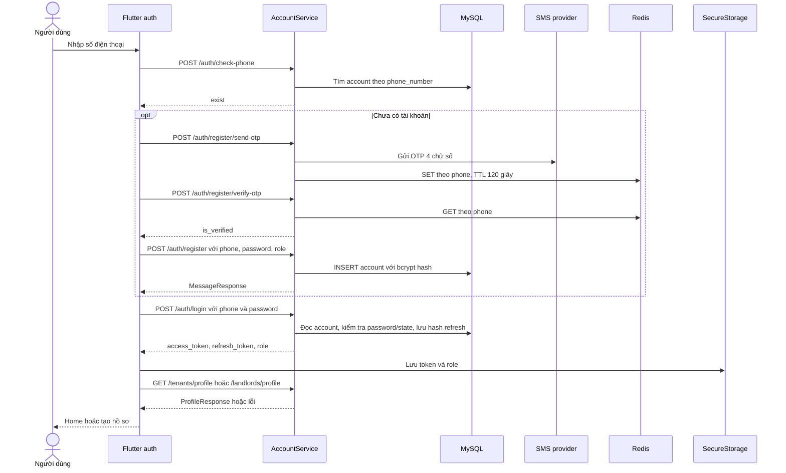

OTP sai/hết hạn trả `is_verified=false`. SMS provider báo fail có thể trả 502, lỗi transport chưa map riêng. Đăng ký trùng có thể trả HTTP 200 với `Register Fail`. `RegisterPasswordPage` vẫn hiển thị thành công nếu BLoC nhận `DataSuccess`. Reset số không tồn tại cũng trả message thất bại trong 200. Đăng nhập sai trả 401. Account khóa trả 403. Server đăng ký/reset trực tiếp nhận body hiện có, không kiểm chứng kết quả OTP hoặc tiêu thụ OTP sau xác minh. `BE services/account_service.py`, `repositories/account_repository.py`, `schemas/account.py`. `FE RemoteRegisterBloc`, `RemoteLoginBloc`, `LoginPage`.

## 2. Khôi phục phiên đăng nhập · Partial

Bắt đầu ở `MyApp` qua `CheckAuthStatusEvent`. Storage có access token thì mở Home và bắt đầu device sync. Refresh xảy ra khi một HTTP request nhận 401.

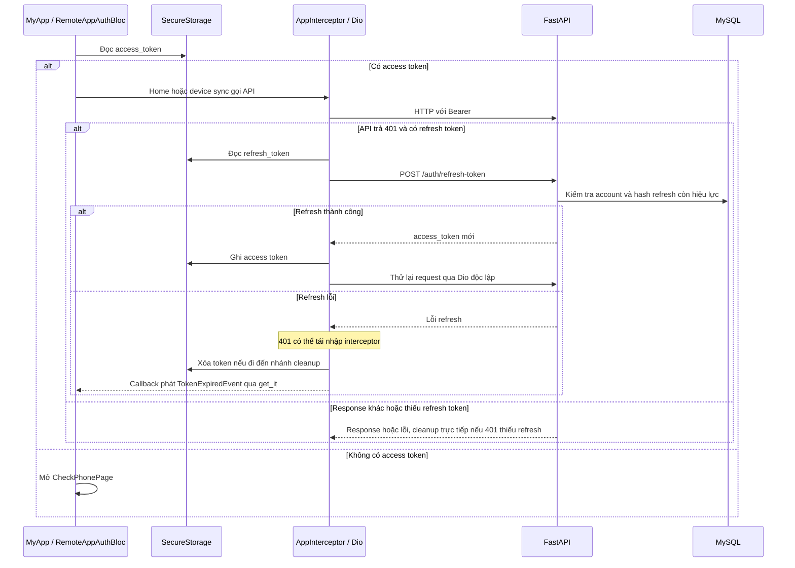

Refresh hết hạn/không hợp lệ/revoked trả 401, account khóa trả 403. Retry thất bại trả lại lỗi ban đầu. Nếu 401 mà thiếu refresh, client đi thẳng đến cleanup. Event từ callback có thể vào instance BLoC khác với UI. `FE lib/core/network/app_interceptor.dart`, `lib/injection_container.dart`, `RemoteAppAuthBloc.checkAuthStatus`. `BE AccountService.refresh_token`.

## 3. Tạo và cập nhật phòng · Partial

Bắt đầu ở `MyRoomsPage`/`RoomDetailPage`, mở `RoomFormPage`. Chọn vị trí bằng `RoomFormLocationCubit`, Goong Places hoặc reverse geocoding thiết bị, tải catalog `GET /interior` và `GET /amenitie`. Form gửi thông số phòng, giá/phí, tọa độ, UUID catalog và metadata ảnh. Ảnh mới được upload trước nếu có.

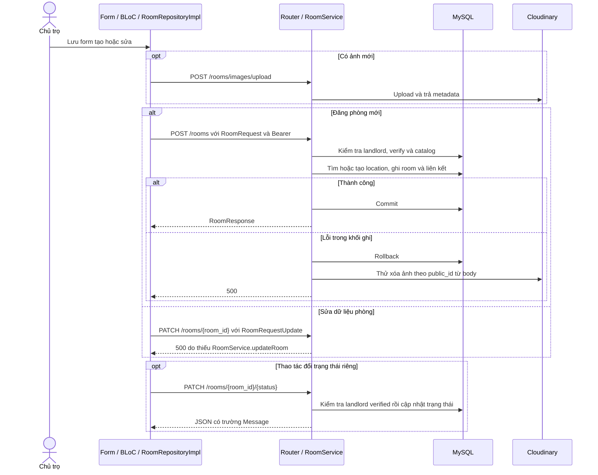

Tạo thiếu landlord trả 404, chưa verify trả 403, catalog ID không hợp lệ trả 400. Đổi trạng thái trả 401 nếu thiếu quyền theo profile/verify, 404 nếu phòng không có. Chưa kiểm tra owner của room và nhận status chuỗi tự do. `BE app/api/v1/room.py`, `services/room_service.py`, `schemas/room.py`. `FE RemoteLandlordRoomBloc` và `RoomApiService`.

## 4. Upload ảnh phòng và avatar · Implemented

Bắt đầu khi submit form phòng hoặc form hồ sơ có file mới từ image picker. Room gửi multipart `images` và `is_thumbnails` lặp. Avatar gửi multipart `image` theo nhánh role. Kết quả là URL HTTPS và `public_id`, room có cờ thumbnail. Các upload route hiện công khai.

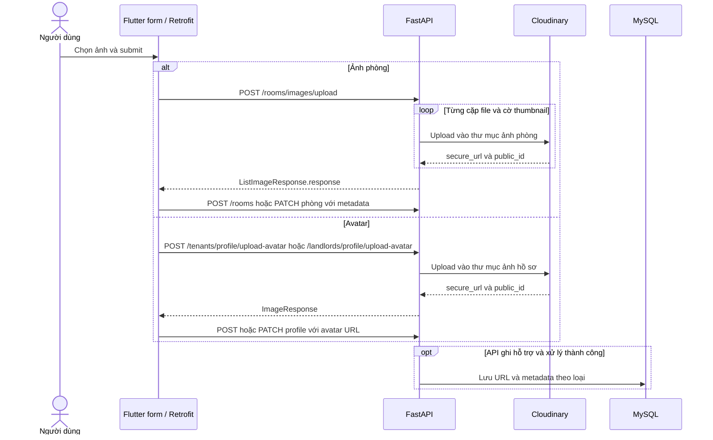

Sai multipart có thể trả 422. Room service dùng `zip` nên số phần tử lệch bị cắt theo list ngắn hơn. Nếu một lần upload trong batch thất bại, ảnh đã upload trước có thể còn trên Cloudinary. Room edit hiện không persist. Avatar mới của chủ trọ có thể upload xong nhưng PATCH hồ sơ bị 422 vì `fullName` khác `full_name`. `BE core/cloudinary_custom.py`, `RoomService.upload_images/postRoom`, `TenantService.upload_avatar`, `LandlordService.upload_avatar`. `FE RoomApiService` và hai profile API service.

## 5. Tìm kiếm phòng theo vị trí · Implemented với tenant có hồ sơ

Bắt đầu ở `SearchRoomsPage`. Người dùng chọn GPS, nhập địa chỉ để geocode trên thiết bị, hoặc chọn khu vực từ catalog Backend. Position nhận lat/lng/radius. District nhận `location_id`, nhãn `district` và radius. Cả hai trả room card, khoảng cách km và `is_saved`.

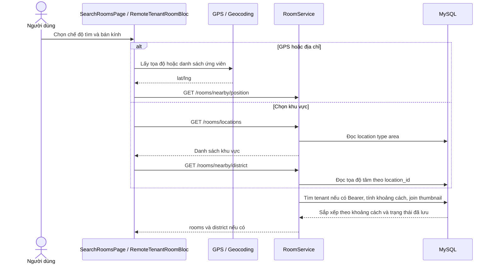

Lỗi có thể đến từ quyền GPS, service tắt, thiết bị/geocoder không hỗ trợ hoặc timeout. Khu vực không tồn tại trả 404. Không có JWT thì `is_saved=false`. JWT hợp lệ mà không có tenant có thể lỗi tại `tenant.id`, kể cả chủ trọ đi qua route tìm kiếm. Query không lọc riêng trạng thái còn trống. `FE RoomLocationDataSource` và `RemoteTenantRoomBloc`. `BE RoomService.searchRoomByPosition/searchRoomsByArea`, `RoomRepository.getRoomByPositionDistance`.

## 6. Lưu phòng yêu thích · Implemented

Bắt đầu khi khách thuê bấm bookmark ở kết quả tìm kiếm hoặc mở `SavedRoomsPage`. `SavedRoomsCubit` dùng cùng trạng thái giữa hai màn hình. API yêu cầu Bearer và hồ sơ tenant.

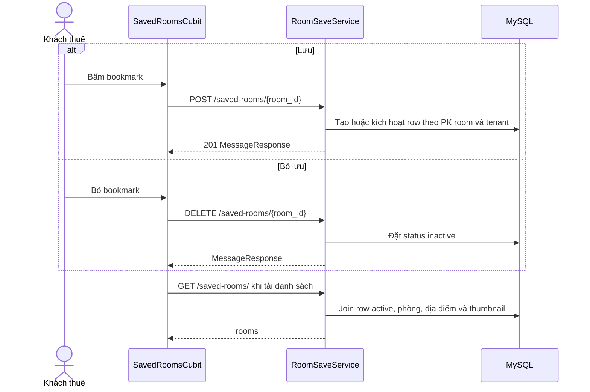

Thiếu tenant hoặc bỏ lưu bản ghi không tồn tại trả 404. Room ID chuỗi sai UUID và FK room không tồn tại chưa được map thành lỗi nghiệp vụ rõ ràng. Danh sách yêu cầu thumbnail. State app được reset khi phiên đổi. `BE services/room_save_service.py` và `repositories/room_save_repository.py`. `FE SavedRoomsCubit`, `SavedRoomsScope`, `SavedRoomApiService`.

## 7. Đặt lịch xem phòng · Implemented

Bắt đầu ở action đặt lịch từ chi tiết phòng. Form gửi `id_room` và `meet_at` đến `POST /appointments/`. Service chuẩn hóa về giờ Việt Nam dạng naive, bỏ microseconds, yêu cầu tương lai và kiểm tra conflict cùng thời điểm theo room hoặc tenant.

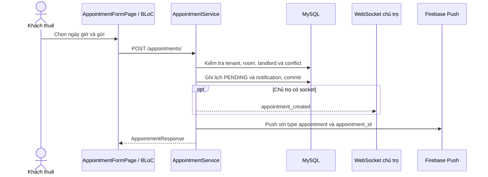

Quá khứ/giờ không hợp lệ trả 400, thiếu entity trả 404, trùng slot active trả 409. `GET /appointments/` list theo người tham gia, bỏ `CANCELLED`. Khách thuê đổi giờ qua `PATCH /appointments/{appointment_id}` hoặc hủy bằng DELETE khi `PENDING/CONFIRMED`. Đổi giờ quay về `PENDING`, không đổi phòng. Hủy chuyển `CANCELLED`. Hai nhánh này lưu inbox và phát WS best effort. `BE AppointmentService.send_appointment/update_appointment/destroy_appointment` và `AppointmentRepository`. `FE AppointmentFormPage`.

## 8. Xác nhận lịch hẹn · Implemented

Bắt đầu ở `AppointmentsPage` của chủ trọ. `PATCH /appointments/{appointment_id}/{status}` lấy ID/status từ path và xác định actor bằng Bearer.

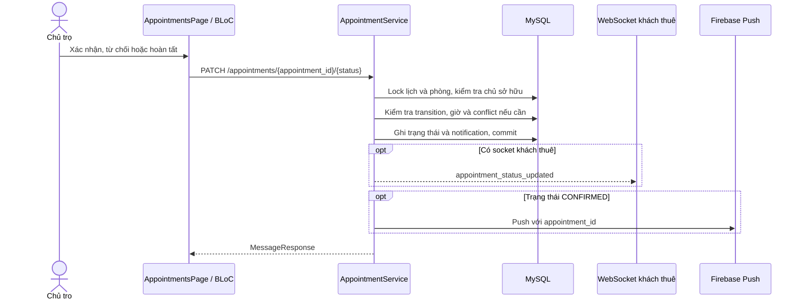

`PENDING → CONFIRMED/REJECTED` và `CONFIRMED → COMPLETED` sau giờ hẹn. Lỗi 400 với status/giờ không hợp lệ, 404 với ID không có hoặc không thuộc chủ trọ, 409 với transition/xung đột. WS/FCM lỗi sau commit được log. Lịch/inbox đã lưu. `BE AppointmentService.confirm_appointment/_commit_and_notify`. `FE RemoteAppointmentBloc`.

## 9. Thuê phòng qua QR · Implemented

Bắt đầu khi chủ trọ tạo QR cho phòng của mình. Khách thuê scan hoặc nhập mã sáu chữ số. Mã đi trong body `{token}`. DB chỉ ghi quan hệ thuê sau verify.

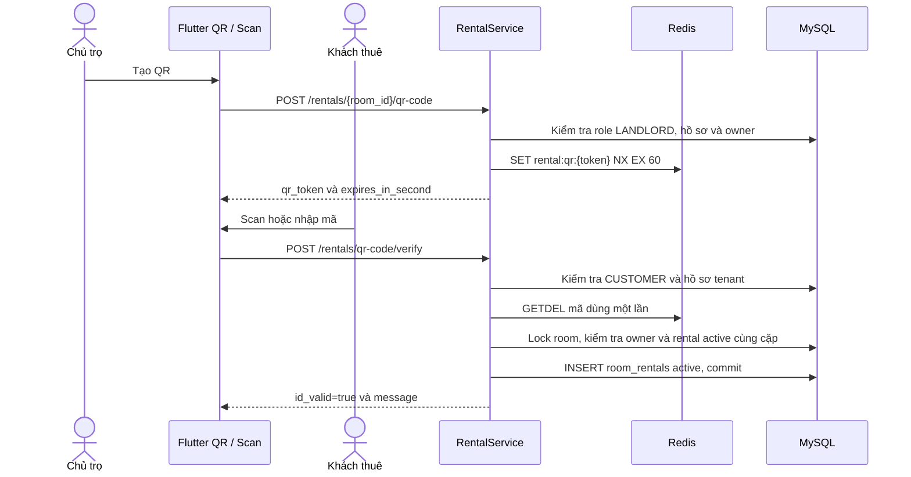

Sai/hết hạn/đã dùng trả 400. Role/owner sai 403. Thiếu entity 404. Quan hệ active trùng 409. Redis lỗi 503. Nếu DB lỗi sau `GETDEL`, người dùng cần mã mới. Luồng không đổi `rooms.status`. `GET /rentals/` trả khách đang thuê cho chủ trọ, `GET /rentals/my-rooms` trả phòng active cho tenant. DELETE do chủ trọ đổi quan hệ thành `deactivate`. `BE RentalService` và `RentalRepository`. `FE RentalQRCodePage`, `RentalScanPage`, `RentalVerifyPage`.

## 10. Chat qua REST/WebSocket · Partial cho realtime

Bắt đầu từ danh sách chat hoặc nút liên hệ chủ trọ trên chi tiết phòng. Target dùng UUID account. Client tải danh sách và lịch sử qua REST, mở một socket broadcast dùng chung ở màn chat. Người gửi dùng REST.

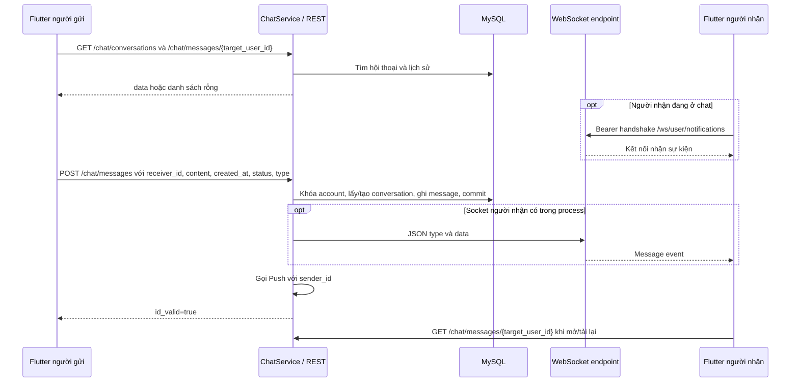

Tự gửi, content rỗng/quá 500 ký tự, time/status/type sai trả 400. Receiver không tồn tại trả 404. Lỗi WS/Push sau commit không làm mất lịch sử. Tin nhắn lưu thời điểm từ client đã chuẩn hóa UTC, `conversations.updated_at` dùng thời gian server. Socket chỉ có một entry/account/process. REST dùng để tải lại khi mất realtime. Flutter chỉ map event `chat_message` trong `ChatRepositoryImpl`. Các sự kiện lịch qua socket không được đưa vào BLoC lịch hiện tại. `BE ChatService.send_message`, `ChatRepository`, `app/api/v1/ws.py`. `FE ChatBloc`, `ChatRepositoryImpl`, `ChatWebSocketService`.

## 11. Đăng ký thiết bị và nhận Firebase Push · Partial

Bắt đầu sau login/restore trên Android. App xin quyền, lấy FCM registration token, dùng `sub` để tìm ID thiết bị trong storage riêng. `POST /devices/` nhận `fcm_token/platform`, PATCH nhận token, DELETE bỏ thiết bị của account hiện tại.

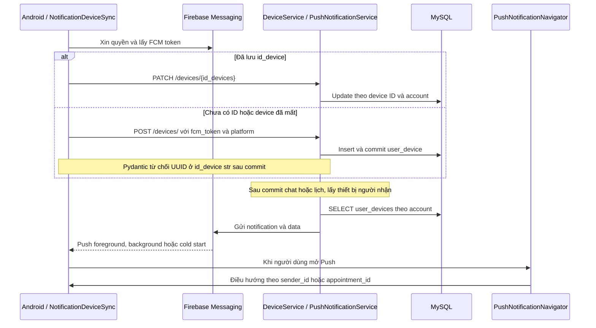

Nếu register trả lỗi, app không có ID để PATCH/DELETE lần sau. Trường hợp token refresh, queue app áp dụng PATCH hoặc đăng ký lại khi 404 với đúng detail. Push type `chat` có `sender_id`. Type `appointment` có `appointment_id`. Firebase báo token unregistered thì Backend xóa device. App đang ở đúng hội thoại thì có thể ẩn banner foreground. Inbox REST vẫn độc lập. `BE DeviceService`, `DeviceRepository`, `schemas/device.py`, `PushNotificationService`. `FE FcmService`, `NotificationDeviceSync`, `PushNotificationNavigator`.

## 12. Đăng xuất · Implemented cho revoke, Partial cho cleanup khi lỗi

Bắt đầu ở `HomePage._onLogout` sau xác nhận. UI lấy refresh token, phát `LogoutEvent`. BLoC chờ cleanup thiết bị rồi gửi refresh token trong body `POST /auth/logout`.

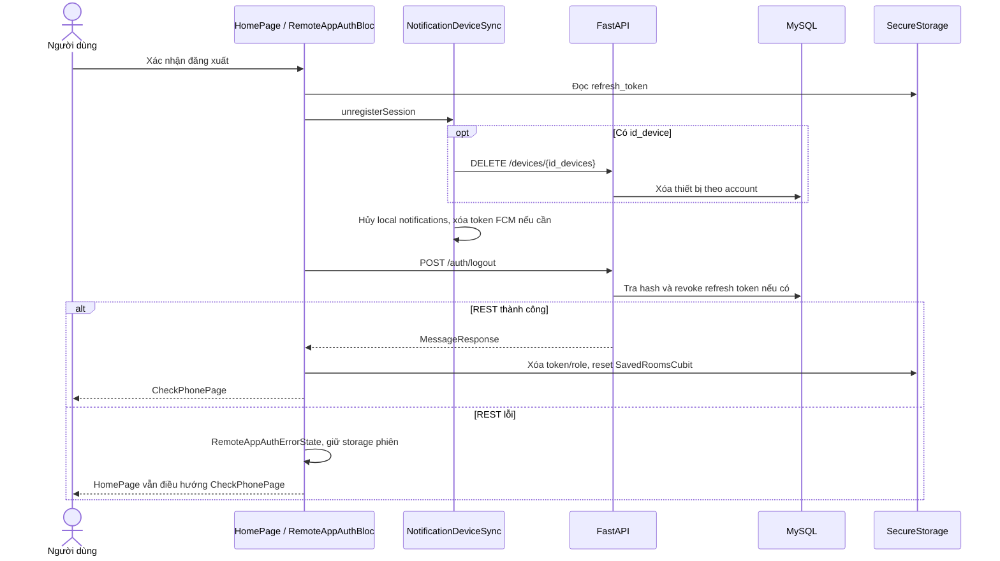

Token không tìm thấy vẫn được Backend trả message thành công. Revoke áp dụng refresh, access JWT hiện hữu vẫn được chấp nhận theo TTL tại các route chỉ dựa trên JWT. Cleanup thiết bị có fallback revoke token cục bộ khi API xóa thất bại. `BE AccountService.logout`, `AccountRepository.revoked_refresh_token`. `FE HomePage._onLogout`, `RemoteAppAuthBloc.logout`, `NotificationDeviceSync.unregisterSession`.
