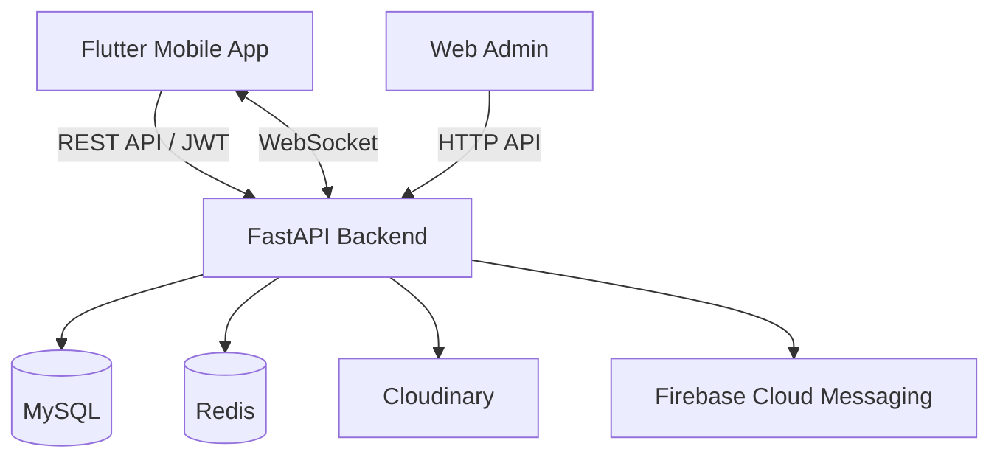

<div align="center">

# 🏠 RoomIO

### Find a place. Make it home.

**A full-stack rental discovery and management platform built with Flutter and FastAPI.**

[](https://flutter.dev/)
[](https://fastapi.tiangolo.com/)
[](https://www.mysql.com/)
[](https://redis.io/)
[](https://firebase.google.com/docs/cloud-messaging)

[Features](#-features) · [Architecture](#-architecture) · [Getting Started](#-getting-started) · [Roadmap](#-roadmap)

</div>

---

## ✨ Overview

**RoomIO** connects people looking for rental accommodation with landlords managing available rooms. The project combines a Flutter mobile application, a Python/FastAPI backend, and a lightweight web admin interface in a single repository.

The system is designed around two primary user roles:

- **Tenants** discover rooms, review details, save favorites, arrange viewings, and communicate with landlords.
- **Landlords** publish and manage listings, respond to viewing requests, and manage rental relationships.

> **Project status:** Active development. Some integrations and flows may still require configuration or testing before production use.

## 📱 Preview

<!-- Add your real screenshots to docs/screenshots/ and replace these placeholders. -->

| Explore rooms | Room details | Messages |
|:---:|:---:|:---:|
| *Screenshot coming soon* | *Screenshot coming soon* | *Screenshot coming soon* |

## 🚀 Features

| Area | Capabilities |
|---|---|
| 🔐 Authentication | Account registration, sign-in, JWT-based authentication, and password recovery flows |
| 🏘️ Room listings | Create, update, browse, and manage rental listings with images and amenities |
| 📍 Location discovery | Search for nearby rooms using coordinates and area-based location data |
| ❤️ Saved rooms | Save and remove favorite listings |
| 📅 Appointments | Request and manage room-viewing appointments |
| 💬 Messaging | Conversations and real-time communication using WebSockets |
| 🔔 Notifications | In-app notifications and Firebase Cloud Messaging device integration |
| 🏠 Rentals | Manage tenant–room rental relationships |
| ⭐ Reviews | Room review functionality |
| 🛠️ Administration | Separate web admin interface |

> Feature availability may vary as development continues.

## 🧰 Tech Stack

| Layer | Technologies |
|---|---|
| Mobile | Flutter, Dart, BLoC/Cubit, Dio, Retrofit, GetIt |
| Backend | Python, FastAPI, SQLAlchemy 2.x (async), Pydantic |
| Database | MySQL, Alembic migrations |
| Cache / supporting services | Redis |
| Authentication | JWT, secure local token storage |
| Real-time | WebSockets |
| Push notifications | Firebase Cloud Messaging (FCM) |
| Media | Cloudinary |
| Web admin | HTML, CSS, JavaScript |

## 🏗️ Architecture



The backend follows a layered structure with API routers, services, repositories, schemas, and SQLAlchemy models. The Flutter application organizes features around data, domain, and presentation layers.

For detailed design notes, see [`Frontend/roomio/docs/architecture/`](Frontend/roomio/docs/architecture/README.md).

## 📂 Repository Structure

```text
RoomIO/
├── Backend/                 # FastAPI application
│   ├── app/                 # API routers, application entry point
│   ├── core/                # Configuration and integrations
│   ├── db/                  # Database setup and seed logic
│   ├── models/              # SQLAlchemy models
│   ├── repositories/        # Data access layer
│   ├── schemas/             # Request / response schemas
│   ├── services/            # Business logic
│   ├── alembic/             # Database migrations
│   └── requirements.txt
├── Frontend/
│   └── roomio/              # Flutter application
│       ├── lib/
│       ├── assets/
│       ├── docs/
│       └── test/
├── Web_admin/               # Web-based admin interface
└── README.md
```

## ⚙️ Getting Started

### Prerequisites

- Python and a virtual environment
- MySQL and Redis
- Flutter SDK and an Android development environment
- Credentials/configuration for any enabled external integrations

### 1. Clone the repository

```bash
git clone https://github.com/codewithhaivu/RoomIO.git
cd RoomIO
```

### 2. Set up the backend

```bash
cd Backend
python -m venv .venv
```

Activate the virtual environment:

**Windows (CMD):**
```cmd
.venv\Scripts\activate
```

**macOS / Linux:**
```bash
source .venv/bin/activate
```

Install dependencies:

```bash
pip install -r requirements.txt
```

Configure the required environment variables for your local database, Redis, authentication secrets, and enabled services. **Do not commit `.env` files or private service-account credentials.** Consult `Backend/core/config.py` for the exact configuration names used by this project.

Apply migrations once the database connection is configured:

```bash
alembic upgrade head
```

Run the API (from `Backend/`):

```bash
uvicorn app.main:app --reload
```

API documentation is typically available at `http://127.0.0.1:8000/docs` when the application uses FastAPI's default docs configuration.

### 3. Run the Flutter application

Open a second terminal:

```bash
cd Frontend/roomio
flutter pub get
flutter run
```

Update the application's API base URLs for your environment. An Android emulator and a physical Android device may require different addresses to reach the backend.

For Firebase-enabled Android builds, provide the appropriate Firebase client configuration locally. Never include Firebase Admin private keys in the mobile application.

### 4. Web admin

The `Web_admin/` folder contains the admin interface. Its API configuration may need to be adjusted for your backend environment before use.

## 🔌 API & Development Notes

FastAPI's interactive OpenAPI documentation is the preferred reference for the exact endpoints and request/response models of your checked-out version.

Additional technical documentation:

- [System overview](Frontend/roomio/docs/architecture/01-SYSTEM-OVERVIEW.md)
- [Backend architecture](Frontend/roomio/docs/architecture/02-BACKEND-ARCHITECTURE.md)
- [Frontend architecture](Frontend/roomio/docs/architecture/03-FRONTEND-ARCHITECTURE.md)
- [Database design](Frontend/roomio/docs/architecture/04-DATABASE-DESIGN.md)
- [System flows](Frontend/roomio/docs/architecture/05-SYSTEM-FLOWS.md)
- [Deployment notes](Frontend/roomio/docs/architecture/06-DEPLOYMENT.md)

## 🗺️ Roadmap

- [ ] Refine authentication session restoration and token lifecycle
- [ ] Improve search performance, pagination, and indexing
- [ ] Polish real-time messaging and unread notification indicators
- [ ] Complete end-to-end testing of FCM notifications
- [ ] Prepare a reproducible deployment environment
- [ ] Add real application screenshots and a walkthrough video
- [ ] Expand automated tests and production hardening

## 🔒 Security

This repository is intended to contain source code, **not live credentials**. Keep database passwords, JWT secrets, Cloudinary secrets, and Firebase Admin credentials outside version control. Rotate any credential that was previously committed or exposed.

## 👨‍💻 Author

**[codewithhaivu](https://github.com/codewithhaivu)**

Built as a hands-on full-stack engineering project, with an emphasis on backend architecture, mobile development, and practical system design.

---

<div align="center">

**RoomIO — Find a place. Make it home.** 🏠

</div>
